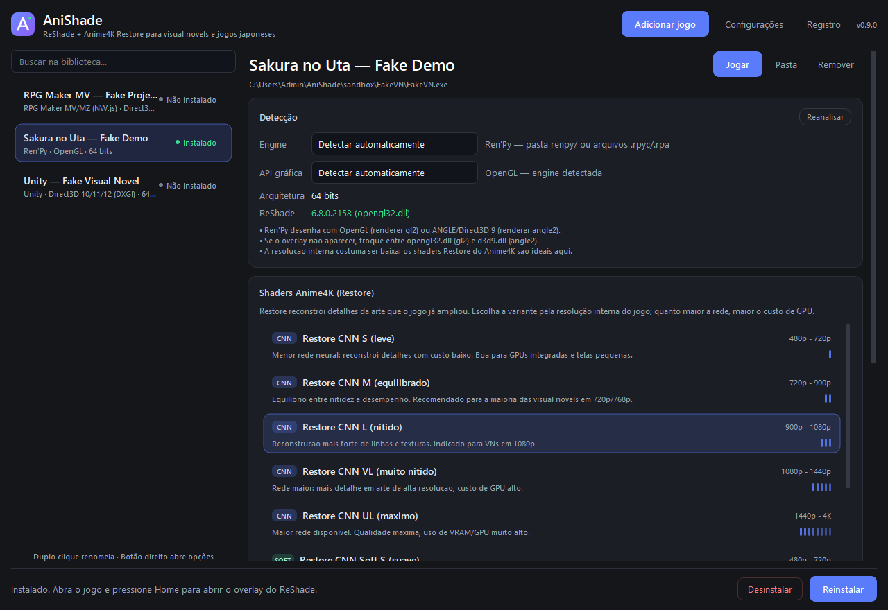
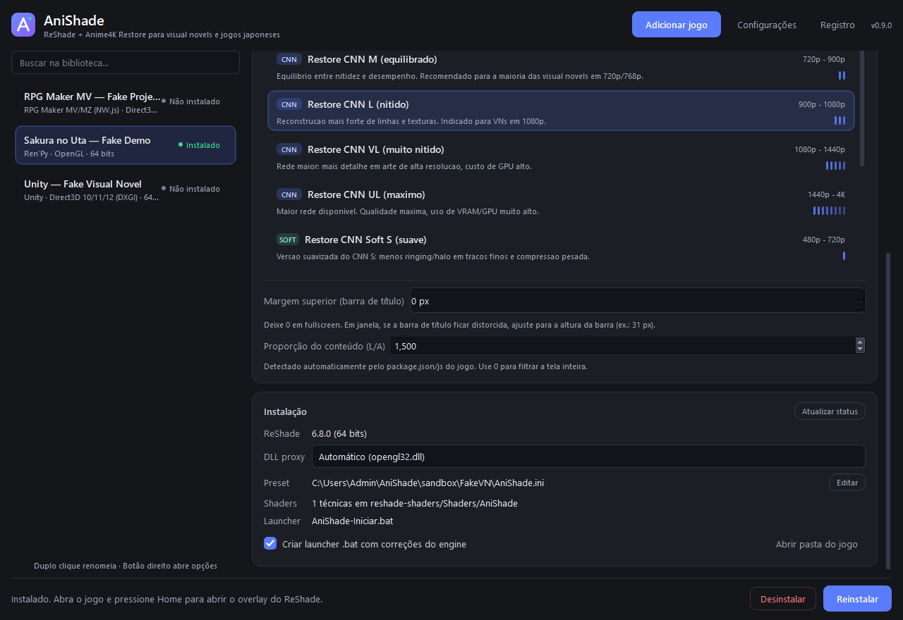

# AniShade

**ReShade + Anime4K Restore para visual novels e jogos japoneses.**

Um gerenciador desktop simples: você aponta para o `.exe` do jogo, o AniShade detecta a engine
e a API gráfica, instala o ReShade com o **Anime4K Restore** e cria um preset pronto para usar.
O ReShade é baixado uma única vez do site oficial e fica em cache para todos os jogos.



## O que ele faz

- **Adiciona jogos pelo executável** (ou arrastando o `.exe` para a janela).
- **Detecta a engine e a API gráfica** lendo a tabela de importações do PE + arquivos do jogo
  (Ren'Py, RPG Maker MV/MZ, RGSS, KiriKiri/XP3, SiglusEngine, BGI, YU-RIS, CatSystem2, RealLive,
  LiveMaker, CMVS, Nitroplus, WOLF, NScripter, Artemis, Unity, Unreal, GameMaker, Godot).
- **Baixa o ReShade 1x** de `reshade.me`, extrai `ReShade32.dll`/`ReShade64.dll` do instalador
  e reutiliza o cache em todos os jogos (funciona offline depois disso).
- **Instala a DLL proxy correta**: `dxgi.dll`, `d3d9.dll`, `opengl32.dll` ou `ddraw.dll`,
  com fallback automático (`d3d11.dll`/`d3d12.dll`) quando já existe outra DLL com o mesmo nome.
- **Instala o shader em ReShade FX** (`.fx`) e gera o preset `AniShade.ini` com a técnica ativa.
- **Desinstalação limpa**: só remove arquivos que o AniShade criou, com verificação de hash.
  Arquivos modificados por você e um `ReShade.ini` pré-existente vão para backup/restauração.
- **Correções por engine**: launcher `.bat` com variáveis recomendadas (`RENPY_RENDERER`, etc.)
  e avisos de conflito (ENB, Special K, DXVK, launcher errado, Vulkan, pasta sem permissão).
- **Plugins para RPG Maker MV/MZ**: interruptores na tela do jogo (e instalação automática junto
  com o ReShade) com backup e restauração limpa de `plugins.js`:
  - `AniShade_HideTextbox.js` — tecla **H** para ocultar/exibir a caixa de texto;
  - `AniShade_NoAltSkip.js` — impede `Alt` / `Alt+Tab` / `Alt+Enter` de pular diálogos (mantendo `Ctrl`);
  - `AniShade_SaveSlots100.js` — expande o limite para **100 slots manuais de save** (MV e MZ).
- **Atualizador oficial do NW.js**: baixa o NW.js oficial (`nwjs.io` / `dl.nwjs.io`) uma única vez
  para o cache local, reutiliza em todos os jogos RPG Maker MV/MZ, corrige problemas comuns do
  `package.json` (`name` ausente, `--autoplay-policy`, flags V8 obsoletas, compatibilidade
  `process.mainModule`) e permite restaurar o backup original.
- **Home abre o overlay do ReShade** (garantido no `ReShade.ini`).
- **Sem banners ou spinner no jogo**: o splash inicial do ReShade ("ReShade 6.x...") e o
  círculo de carregamento no canto superior esquerdo (ao alternar janela/fullscreen) são
  ocultados na DLL instalada, além de preset/tutorial/toast desligados no `ReShade.ini`.
  Pressione **Home** quando quiser abrir o overlay normalmente.

## Sobre os shaders (GLSL → ReShade FX)

O pacote oficial do Anime4K é escrito em **GLSL para MPV/libplacebo**. O ReShade **não carrega
`.glsl`** — ele só compila o próprio formato ReShade FX (`.fx`). Por isso o AniShade **converte
os shaders oficiais** (blocos `//!DESC`/`//!HOOK`/`//!SAVE` + CNN) para `.fx`, com:

- uma pass **Copy** que tira um snapshot do frame antes de filtrar (sem feedback entre frames);
- `anishade_mul` no lugar de matrizes `float4x4` (sem ambiguidade de layout);
- alfa forçado a 1 nos pixels filtrados;
- **máscara de letterbox/pillarbox** pela proporção do conteúdo, preservando as barras;
- margem superior configurável para jogos NW.js cuja janela inclui a barra de título no swapchain.

Os shaders são regerados a partir de `vendor/anime4k/*.glsl` por `tools/build_fx.py`.
Nenhum binário/port pronto é baixado: só os `.glsl` oficiais (MIT, bloc97) são usados como fonte.

## Requisitos

- Windows 10/11 (64 bits).
- Python 3.10+ para rodar do código-fonte (ou use o `.exe` gerado).
- GPU com Direct3D 9/11 ou OpenGL. Para Vulkan, veja [Limitações](#limitações).

## Rodar do código-fonte

```powershell
python -m venv .venv
.venv\Scripts\activate
pip install -r requirements.txt
python run.py
```

Também funciona via `python -m anishade`.

## Gerar o executável

```powershell
powershell -ExecutionPolicy Bypass -File build_exe.ps1
# gera dist\AniShade.exe (um único arquivo, sem console)
```

Para uma pasta portátil (abre mais rápido): `build_exe.ps1 -OneDir`.

## Como usar

1. **Adicionar jogo** → escolha o `.exe` que realmente abre o jogo (não o launcher/config).
2. Confira **Engine**, **API gráfica** e **Arquitetura**. Se algo estiver errado, force a
   detecção nos combos (o app reanalisa na hora).
3. Escolha a **variante do Anime4K Restore** pela resolução interna do jogo.
4. O campo **DLL proxy** fica em `Automático` na maioria dos casos; se outro mod já usa
   `dxgi.dll` (Special K, DXVK, ENB), o AniShade escolhe `d3d11.dll`/`d3d12.dll` sozinho e
   mostra o nome efetivo. Você também pode forçar um nome manualmente.
5. Clique em **Instalar ReShade + Anime4K**.
6. Abra o jogo e pressione **Home** para abrir o overlay do ReShade.
7. Para trocar de variante depois, selecione outra e clique em **Aplicar alterações**
   (o preset antigo editado é salvo em backup).

### Restore

O Restore é o shader principal — reconstrói linhas e texturas que o jogo ampliou com
bilinear/nearest. **Não faz upscale**; trabalha na resolução final e o efeito é sutil por
natureza. Para comparar, abra o overlay (Home) e marque/desmarque a técnica.

| Variante | Resolução indicada | Custo de GPU |
|---|---|---|
| Restore CNN S | 480p – 720p | 1x |
| Restore CNN M (padrão) | 720p – 900p | 2x |
| Restore CNN L | 900p – 1080p | 3x |
| Restore CNN VL | 1080p – 1440p | 5x |
| Restore CNN UL | 1440p – 4K | 8x |
| Restore CNN **Soft** S/M/L/VL/UL | mesmas faixas | idem |

As variantes **Soft** são menos agressivas: melhores para arte suave, gradientes e fundos
desfocados, ou quando o CNN normal realça demais o ringing.

### Barras pretas e proteção contra feedback nas bordas

Jogos NW.js/Chromium (e outros compositores com swapchain parcial) muitas vezes não redesenham
as barras pretas de letterbox/pillarbox (nem a barra de título em modo janela) a cada frame. Sem
proteção, a CNN do Anime4K reprocessa a própria saída 60x por segundo nessas áreas e cria um
ruído colorido crescente nas laterais.

Os shaders `.fx` do AniShade incluem uma **proteção temporal automática de 4 buffers**
(`texPrev1..4`): qualquer pixel cujo valor no backbuffer ainda seja a saída anterior do próprio
shader é mantido intacto sem ser refiltrado, enquanto 100% da área ativa do jogo recebe a
restauração completa do Anime4K — sem depender de recorte por proporção do `package.json`.

- **Proporção do conteúdo**: padrão `0` (tela inteira). Só precisa ser alterada se você quiser
  restringir o shader manualmente.
- **Margem superior** (px): padrão `0`. Opcional em modo janela se quiser pular a barra de título.

## Arquivos criados no jogo

| Arquivo | Função |
|---|---|
| `dxgi.dll` / `d3d9.dll` / `opengl32.dll` / `ddraw.dll` | DLL proxy do ReShade |
| `ReShade.ini` | configuração do ReShade (mesclada, sem apagar suas chaves) |
| `AniShade.ini` | preset com a técnica ativa e as máscaras |
| `reshade-shaders\Shaders\AniShade\*.fx` | shader ReShade FX selecionado |
| `reshade-shaders\Shaders\AniShade\_anishade_shaders.json` | registro dos shaders instalados |
| `AniShade-Iniciar.bat` | launcher opcional com correções do engine |
| `(www\)js\plugins\AniShade_HideTextbox.js` | plugin RPG Maker MV/MZ para ocultar a caixa de texto com `H` |
| `(www\)js\plugins\AniShade_NoAltSkip.js` | plugin RPG Maker MV/MZ para impedir `Alt` / `Alt+Tab` de pular diálogos |
| `(www\)js\plugins\AniShade_SaveSlots100.js` | plugin RPG Maker MV/MZ que libera 100 slots manuais de save |

O manifesto de cada jogo fica em `%LOCALAPPDATA%\AniShade\games\<id>.json`, com hash de cada
arquivo. É isso que permite desinstalar sem tocar em arquivos de terceiros.



## Cache e pastas

- ReShade: `%LOCALAPPDATA%\AniShade\cache\reshade\<versão>\`
- Downloads: `%LOCALAPPDATA%\AniShade\cache\downloads\`
- Backups: `%LOCALAPPDATA%\AniShade\backups\<jogo>\`
- Logs: `%LOCALAPPDATA%\AniShade\logs\anishade.log` e `ReShade.log` na pasta do jogo

## Solução de problemas

**O overlay não abre com Home**
- Confira `ReShade.ini` → `[INPUT] KeyOverlay=36,0,0,0` (36 = Home).
- Alguns jogos capturam o teclado; tente `ReShade.ini` com `InputProcessing=2` (já padrão).

**Vejo ruído colorido nas laterais ou na barra de título**
- Ajuste **Proporção do conteúdo** para a proporção real (ex.: 1.5) e/ou **Margem superior**
  para a altura da barra de título (ex.: 31 em modo janela).
- Em fullscreen, margem 0. Se o jogo estiver em 4:3, a proporção é `1.3333`.

**O jogo abre, mas nada parece filtrado**
- Restore é sutil; compare marcando/desmarcando a técnica no overlay (Home).
- Use uma variante maior (L/VL) ou confira se o `ReShade.log` mostra
  `Successfully compiled ... Anime4K_Restore_...fx`.
- Se o log mostrar `Failed to compile`, envie o trecho do erro.

**Vulkan**
- ReShade não carrega por proxy DLL em Vulkan. Inicie o jogo em D3D11/OpenGL
  (ex.: `-force-d3d11`) ou use a injeção global do ReShade.

## CLI (headless)

```powershell
python -m anishade.cli info "C:\Jogos\VN\game.exe"
python -m anishade.cli install "C:\Jogos\VN\game.exe" --variant cnn_m --aspect 1.5
python -m anishade.cli uninstall "C:\Jogos\VN\game.exe"
python -m anishade.cli variants
python -m anishade.cli cache --download
python -m anishade.cli list
```

## Limitações

- Somente **Restore** (o escopo escolhido). Denoise/Clamp/upscalers do Anime4K não estão incluídos.
- **Vulkan** não pode ser injetado por proxy DLL.
- Não gerencia add-ons (depth buffer, texturas).
- Jogos com **anti-cheat** (EAC/BattlEye) podem bloquear ou banir com ReShade instalado.
- Se o `.exe` escolhido for apenas um launcher, o ReShade não será carregado pelo jogo real.
- O preset é reescrito ao aplicar uma nova variante; edições feitas no overlay são
  preservadas em backup antes.

## Estrutura do projeto

```
anishade/
  pe.py            leitor de PE (bits, imports, delay imports)
  engines.py       fingerprints e correções por engine
  detect.py        análise do jogo, API, conteúdo, conflitos, ReShade existente
  glsl_to_fx.py    tradutor Anime4K GLSL -> ReShade FX (copy pass, máscaras)
  reshade.py       download oficial + extração das DLLs + cache
  anime4k.py       catálogo de variantes, deploy .fx e preset
  installer.py     instalação/desinstalação com manifesto e backups
  store.py         biblioteca e preferências (JSON atômico)
  cli.py           interface headless
  ui/              janela principal, tema, delegates, configurações
vendor/anime4k/     fontes GLSL oficiais v4.0.1 (MIT, bloc97)
vendor/anime4k_fx/  shaders ReShade FX gerados por tools/build_fx.py
tests/              testes de PE, conversão, presets, INI e instalação
tools/              geração de .fx, ícone, fixtures e screenshots
```

## Testes

```powershell
python -m unittest discover -s tests -v
```

## Créditos e licenças

- **ReShade** — © crosire, licença BSD-3. O AniShade **não redistribui** binários: baixa o
  instalador oficial em `reshade.me` e extrai as DLLs localmente.
- **Anime4K** — © bloc97, licença MIT. Os `.glsl` oficiais acompanham o aplicativo
  (`vendor/anime4k`, v4.0.1) e os `.fx` são uma conversão gerada a partir deles.
- **PySide6 / Qt** — LGPLv3.

O código do AniShade é MIT. Respeite os termos de uso de cada jogo e não use ReShade em
títulos com anti-cheat.
